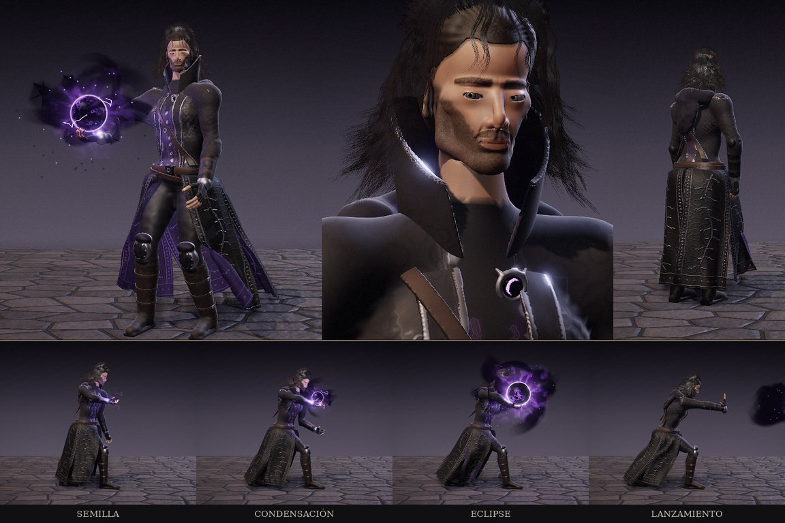
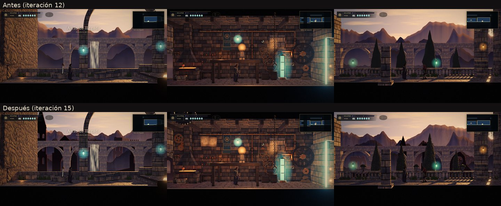
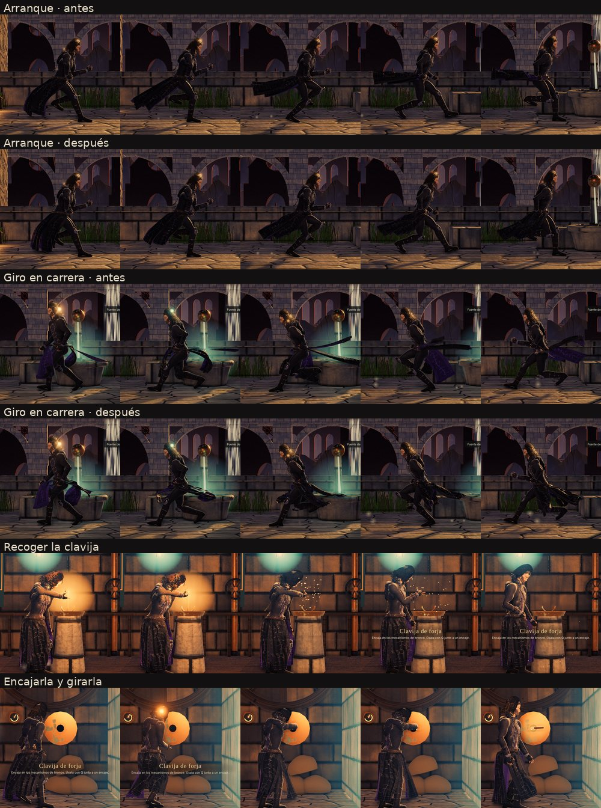

# Iteraciones 12–15 — mago de sombras, escenario, movilidad y herramientas

Continuación del juez estricto v3 ([`../CALIDAD.md`](../CALIDAD.md)). La usuaria pidió seguir
comparando el personaje con su lámina «UMBRAL · Mago de Sombras» y, después, mejorar de forma
notable el detalle del escenario, la naturalidad del movimiento y el uso de herramientas. La lámina
no se versiona; sus cifras siguen en `tests/judge/referencia_mago.json`. Las salas se miden con el
juez de estilo v2 (`tests/judge/style.py`, medianas de referencia en `tests/judge/referencia.json`).

## Rondas

**12 · Vestuario y rostro.** Filigrana de enredadera de plata y repujado en los faldones del abrigo
(la lámina tiene volutas en cada paño), barba más poblada con mejor transición a la piel, cejas con
vello dibujado por el sombreador y un paño violeta en la espalda, como en el recuadro posterior de
la lámina. En la medición final apareció una mancha de piel entre la barba y el pómulo: era el cuello
del cuerpo asomando por el hueco de la mejilla. El cuello del cuerpo es ahora más corto y fino, y la
mancha desaparece en los tres planos del rostro.

**13 · Escenario.** Ruinas góticas pintadas por código en la bruma del fondo. Las cordilleras llevan
roca pintada (facetas de Voronoi en dos escalas, cárcavas y ruido fino) que se funde con la bruma en
los planos lejanos. El taller del maestro gana un tren de engranajes que giran engranados (cada rueda
a la velocidad que le toca por su número de dientes), dos planos del maestro con escritura inventada,
un polipasto con su carga atada y una rueda de primer plano que pasa por delante de la cámara; la sala
tiene además más exposición, porque se leía casi negra. La terraza suma macetones, un tambor de
columna caído y dos bandadas de pájaros a distinta profundidad. El follaje usa una textura propia con
relieve (masas de hojas en lugar de un verde plano).

**14 · Movilidad.** Los faldones del abrigo se amortiguan respecto al cuerpo, no respecto al mundo:
antes, al correr, se quedaban atrás en horizontal como una tabla y al frenar se levantaban por delante.
La tela tiene ahora rozamiento con el aire, no se estira (cada fila está a lo sumo a un 6 % de su
largo de la de arriba) y su vaivén tiene un tope de 72°. El aterrizaje es más visible: flexión de
rodillas, tronco hacia delante y un brazo que compensa, con un muelle más lento.

**15 · Herramientas.** Coger la clavija de forja: Aren se acerca hasta quedar a unos 40 cm del
pedestal, la toma de pie con la mano del lado de la cámara, la mira un instante y la guarda en la
bolsa del cinto (antes se arrodillaba y la clavija desaparecía). Encajarla en la compuerta: se vuelve
hacia el muro y da un paso en profundidad, saca la clavija de la bolsa, la mete en la cerradura y le
da un cuarto de vuelta con giro de muñeca; solo entonces la compuerta sube y la clavija sigue girando
con el mecanismo. Los dedos se abren, cierran y relajan en cada fase.

Pruebas funcionales: 30/30. Errores de consola: 0.

## Escenario: métricas por sala (antes de la ronda 13 / después de la ronda 15)

| Sala | detail antes | detail después | l_p95 antes | l_p95 después | acento % antes | acento % después |
|---|---|---|---|---|---|---|
| Atrio | 4,3 | 5,0 | 77,9 | 77,9 | 0,18 | 0,18 |
| Galería | 4,4 | 4,4 | 56,2 | 55,2 | 2,39 | 2,53 |
| Canal | 4,0 | 4,4 | 79,8 | 79,8 | 0,00 | 0,00 |
| Taller | 2,8 | 4,1 | 48,3 | 55,1 | 0,61 | 1,18 |
| Terraza | 3,2 | 3,7 | 79,0 | 78,9 | 0,37 | 0,30 |
| **Mediana** | **4,0** | **4,4** | 77,9 | 77,9 | 0,37 | 0,30 |

Objetivo del juez v2: `detail` entre 5 y 12 (mediana de las referencias 6,25) y `l_p95` entre 55 y 80.
El taller, que era la sala más pobre, sube un 46 % en detalle y entra en el rango de luces. La mediana
del nivel sube de 4,0 a 4,4: mejor, pero todavía por debajo del objetivo. Solo el atrio llega a 5.

## Movilidad: ángulo del faldón respecto a la vertical

| Situación | Antes | Después |
|---|---|---|
| Al correr | hasta −90° (horizontal) | pico de −60° al arrancar, −15 a −35° en carrera |
| Al frenar | hasta +98° (se levanta por delante) | ≤ 50° |

## Personaje: métricas por recuadro (motor / referencia)

| Recuadro | detail it. 11 | it. 15 | ref. | fine it. 11 | it. 15 | ref. | violeta % it. 11 | it. 15 | ref. |
|---|---|---|---|---|---|---|---|---|---|
| Cuerpo 3/4 | 2,88 | 2,93 | 6,97 | 7,44 | 7,37 | 7,00 | 7,01 | 7,68 | 0,63 |
| Rostro | 3,08 | 3,04 | 6,36 | 7,79 | 7,83 | 8,37 | 0,21 | 0,22 | 0,41 |
| Espalda | 2,82 | 3,05 | 6,63 | 7,96 | 8,01 | 7,18 | 0,10 | 0,20 | 0,39 |
| Semilla | 1,29 | 1,73 | 6,01 | 4,38 | 4,88 | 6,28 | 1,59 | 1,10 | 0,13 |
| Condensación | 1,81 | 2,19 | 7,23 | 4,67 | 5,14 | 7,30 | 2,98 | 2,69 | 0,73 |
| Eclipse | 1,82 | 2,16 | 8,16 | 4,67 | 5,04 | 8,01 | 7,73 | 7,86 | 1,99 |
| Lanzamiento | 1,23 | 1,59 | 7,62 | 4,37 | 4,88 | 7,55 | 0,11 | 0,10 | 1,32 |

La filigrana sube el detalle de la espalda y de las fases del poder (entre un 15 y un 35 %), pero el
motor sigue en un 30–45 % del detalle de la lámina: el plató neutro no tiene el fondo pintado de la
referencia y el abrigo, aunque ya tiene repujado, no llega a la densidad de bordado de la pintura. El
eclipse se queda en 3,95 veces el violeta de la lámina, justo bajo el tope de 4. En el cuerpo de 3/4
el violeta sigue alto por el forro del abrigo.

## Nota del juez (10 = la lámina)

| Criterio | Peso | It. 11 | It. 15 | Qué falta |
|---|---|---|---|---|
| Rostro y cabello | 25 % | 3,5 | 3,7 | Barba y cejas mejoran y la mancha de la mejilla desaparece, pero el rostro sigue leyéndose como un maniquí: planos lisos y sin la piel de la pintura. El cabello sigue pareciendo un casco en el juego |
| Vestuario | 25 % | 5,0 | 5,4 | Filigrana y repujado presentes; faltan bordado más denso, capucha con pliegues profundos y hombreras más angulosas |
| Manos y gestos | 15 % | 5,0 | 5,4 | Gestos nuevos con herramienta (coger, mirar, guardar, encajar, girar) con dedos que acompañan; faltan tendones y nudillos marcados |
| Poder | 15 % | 5,5 | 5,5 | Sin cambios en esta tanda: humo más denso y rayos finos alrededor del núcleo |
| Poses y naturalidad | 20 % | 5,0 | 5,6 | El abrigo ya no se levanta como una tabla y el aterrizaje se nota; la zancada de la lámina sigue siendo más baja |
| **Ponderada** | | **4,7** | **5,0** | |

## Distancia honesta

El personaje llega a 5,0 sobre 10 frente a la lámina: el diseño entero se lee bien, pero el acabado
sigue siendo claramente sintético. El rostro es el techo de esta ruta técnica (todo generado por
código y dibujado en tiempo real en el navegador); acercarlo a la pintura exigiría una malla esculpida
o escaneada con texturas de piel, que hoy no forman parte del proyecto. El escenario sube de 4,0 a 4,4
de detalle mediano y queda aún por debajo del objetivo de 5; la terraza (3,7) es la sala con más
margen. Los siguientes pasos con más rendimiento: más elementos de primer plano y relieve en la
terraza y el canal, bordado más denso en el abrigo, y una pasada de forma y piel del rostro.
