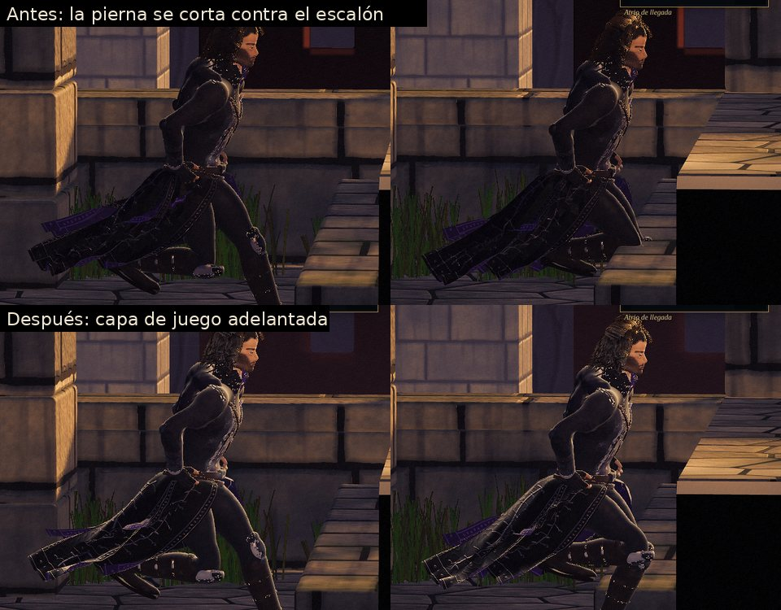
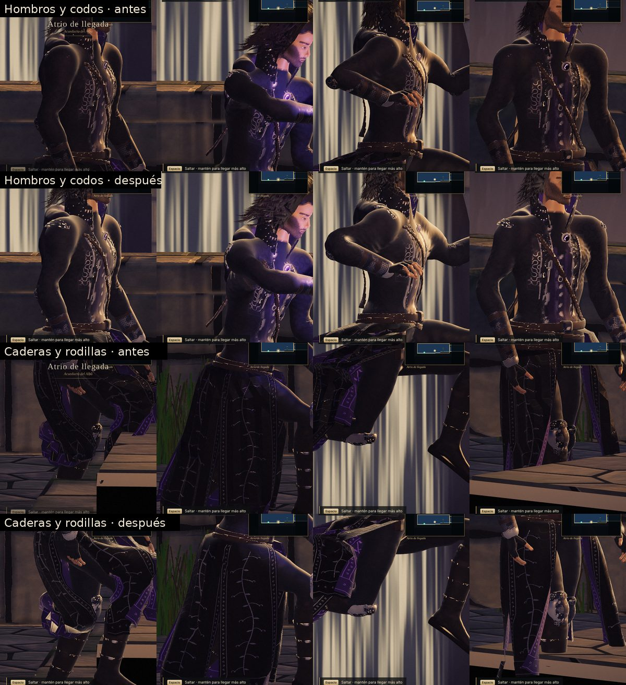
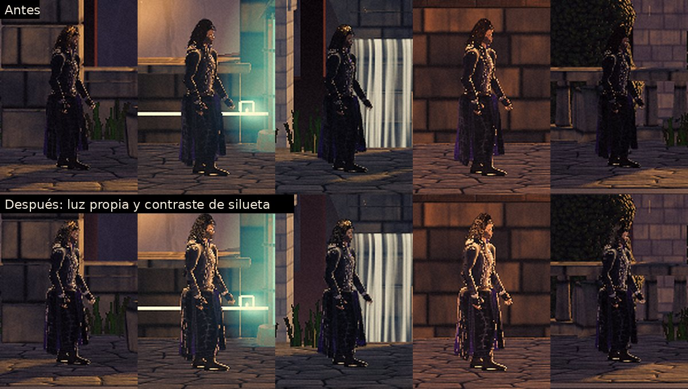
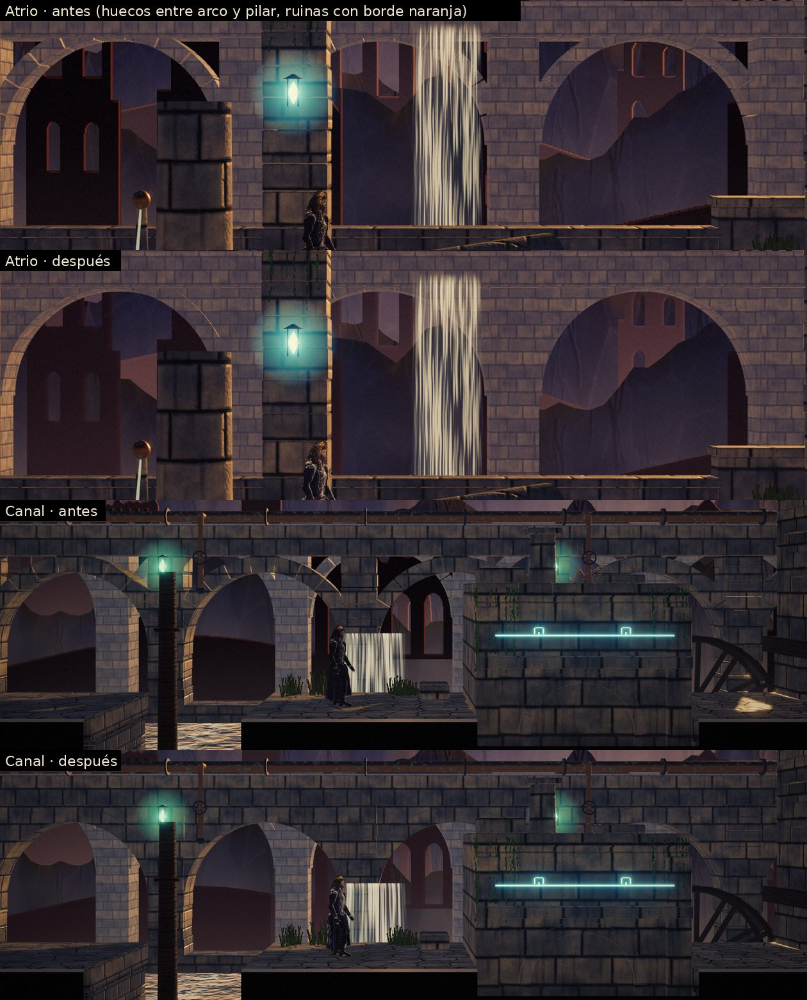

# Iteración 16 — naturalidad: cortes, articulaciones, silueta y juntas

La usuaria jugó la versión publicada y señaló que todo se veía «ficticio»: se notaban las costuras
entre los bloques y en el personaje, Aren a veces se fundía con el escenario, un brazo podía
atravesar un bloque y las articulaciones eran poco realistas. Esta ronda analiza cada síntoma con
capturas cercanas en el motor y aplica las técnicas habituales del género para corregirlo.

## Diagnóstico

| Síntoma | Causa en el motor |
|---|---|
| Un brazo o una pierna «atraviesa» un bloque | Los bloques tienen cuerpo en profundidad: su cara delantera está a z = 1,3 y el plano de juego a z = 0. Al correr junto a un escalón o una pared, la parte del cuerpo que se solapa en pantalla quedaba detrás de esa cara y se cortaba en seco. |
| Hombros como bolas, codos y rodillas de bisagra | Los pesos de piel salían de las primitivas del modelado y cambiaban de hueso en pocos milímetros; el deltoides pesaba al 100 % en el brazo y giraba entero con él. La mezcla lineal de matrices de Three.js, además, encoge la articulación al doblarse. |
| Aren se funde con el fondo | Abrigo carbón y cuero oscuro sin luz propia: contra piedra en sombra la silueta desaparecía y por dentro se leía como una mancha negra. |
| Costuras entre bloques | Huecos triangulares entre el trasdós de los arcos, los pilares y la cornisa en los dos acueductos (se veía el fondo oscuro a través); rendijas de 1,6 cm entre los sillares de los pilares y de 2 cm entre los bloques de coronación, con frentes desalineados hasta 6 cm. |
| Fondo «de cartón» | Las ruinas pintadas tenían un borde de 2 px casi naranja en todo el contorno, alfa binarizado (borde dentado) y color plano. |

## Técnicas aplicadas

**Capa de juego adelantada en profundidad** (`src/render/depthPull.js`). Es la solución estándar del
2.5D: los personajes y sus efectos se prueban contra el búfer de profundidad como si estuvieran 2 m
más cerca de la cámara (nunca más del 16 % de la distancia a la cámara), lo justo para pasar la cara
de escalones y zócalos, que llega a z = 1,75. Solo se toca la profundidad del vértice; la posición en
pantalla, la luz, las sombras y la niebla no cambian, y los primeros planos de verdad (columnas a
z ≥ 2,8) siguen tapando a Aren. Se aplica a Aren, su abrigo,
los saqueadores y sus capas, los vigías, la esfera del eclipse, las saetas, la estela y las partículas
de combate; la niebla y las motas del escenario no se adelantan.

**Pesos de piel suavizados por difusión** (`src/render/humanoid.js`). Tras calcular los pesos, se
difunden 36 veces sobre la malla (Laplaciano por aristas), unos 6 cm alrededor de cada articulación,
como un pintado de pesos a mano; la difusión no cruza de una pierna a la otra por la entrepierna. El
deltoides es algo más contenido.

**Piel con cuaterniones duales** (`src/render/charMaterial.js`, Kavan et al. 2007). Cada vértice se
mueve con una mezcla de transformaciones rígidas en lugar de una mezcla de matrices: la articulación
conserva el volumen al doblarse y no se estrecha al girar.

**Luz propia de personaje** (`CHAR_EDGE` en `charMaterial.js`). Como el enlace de luces de los motores
de cine: un contorno más ancho desde la luz de recorte y un relleno suave desde la cámara que solo
afecta a los personajes (cuerpo, abrigo y cabello; en el cabello, muy contenido para que no aclare el
castaño).

**Contraste de silueta adaptado al fondo** (`src/render/post.js`). Aren se dibuja además en una máscara
a media resolución. En el posproceso, solo dentro de su silueta y solo donde el borde y el fondo
inmediato tienen casi la misma luz, el borde se empuja en el sentido que ya separa (o se aclara si el
fondo es oscuro y se oscurece si es claro). No dibuja línea de contorno ni halo sobre el escenario, y
se apaga en los planos cortos, donde Aren ya llena el encuadre.

**Juntas** (`src/render/architecture.js`). Enjutas (el muro entre arco, pilares y cornisa) en los dos
acueductos; juntas de dovelas finas (antes 6 cm de rendija); sillares de pilar y bloques de coronación
a hueso, con el canto redondeado haciendo de llaga, y frentes casi alineados.

**Ruinas del fondo** (`src/render/environment.js`). La luz del sol se difumina medio metro hacia dentro
desde los cantos de la derecha y de arriba, cada masa se aclara hacia el lado del sol y se oscurece
hacia el contrario (volumen), cada ruina tiene su propia bruma (unas más lejos que otras) y el borde
conserva el suavizado del dibujo (alfa a cobertura con el MSAA).

## Evidencias

Pruebas funcionales: 32/32. Errores de consola: 0. La nueva prueba «Aren entero junto a un escalón»
compara la silueta completa de Aren con lo que se ve de él en la imagen final al correr contra un
escalón: se ve el 94,8 % de la silueta con la capa adelantada frente al 84,8 % sin ella (el resto son píxeles donde Aren y el fondo tienen el mismo color).

### Separación figura-fondo (máscara exacta de Aren, cinco salas, cámara de juego)

| Sala | L Aren antes | L Aren después | L fondo | contorno separado antes | después |
|---|---|---|---|---|---|
| Atrio | 20,1 | 28,8 | 43,8 | 0,84 | 0,81 |
| Galería | 36,6 | 51,1 | 80,5 | 0,81 | 0,82 |
| Canal | 19,5 | 28,6 | 72,1 | 0,76 | 0,81 |
| Taller | 34,9 | 53,7 | 51,7 | 0,78 | 0,82 |
| Terraza | 14,2 | 24,0 | 40,1 | 0,79 | 0,76 |
| **Media** | 25,1 | 37,2 | | **0,80** | **0,80** |

`L` es la luminancia media (0–255) de Aren y del anillo de fondo que lo rodea; «contorno separado» es
la fracción del borde de la silueta cuyo fondo inmediato difiere en más de 12 niveles.

## Distancia honesta

- **Cortes contra bloques**: resueltos para personajes y efectos; la prueba lo vigila. A cambio, Aren
  se dibuja ahora delante de la hiedra y la hierba que cuelgan justo delante del plano de juego, que
  antes le tapaban algún borde.
- **Articulaciones**: los hombros ya no giran como una bola y codos y rodillas se doblan con volumen,
  pero el hombro con el brazo en alto sigue siendo voluminoso. El techo de esta ruta (cuerpo modelado
  con primitivas y pesos automáticos) está en los pliegues y la musculatura: una malla esculpida con
  pesos pintados o huesos auxiliares de corrección en hombro y cadera daría el siguiente salto. No
  hay una cifra fiable de «naturalidad»; la evidencia son los primeros planos de arriba.
- **Silueta**: Aren se lee mejor por dentro (luz media de la figura un 48 % más alta: se ven el
  abrigo, las manos y los adornos en lugar de una mancha negra) y mejora donde más se fundía (canal y
  taller, +0,05 de contorno separado). La media del contorno no cambia (0,80) y en la terraza baja un
  poco: aclarar la figura la acerca a los fondos de tono medio. Esta medida tiene ruido por el grano
  de película.
- **Juntas y fondo**: desaparecen los huecos triangulares del acueducto y las rendijas entre bloques;
  las ruinas pierden el borde naranja de recorte y ganan volumen y bruma. Siguen siendo pinturas
  planas a 76 y 140 m: de cerca no tienen relieve.
