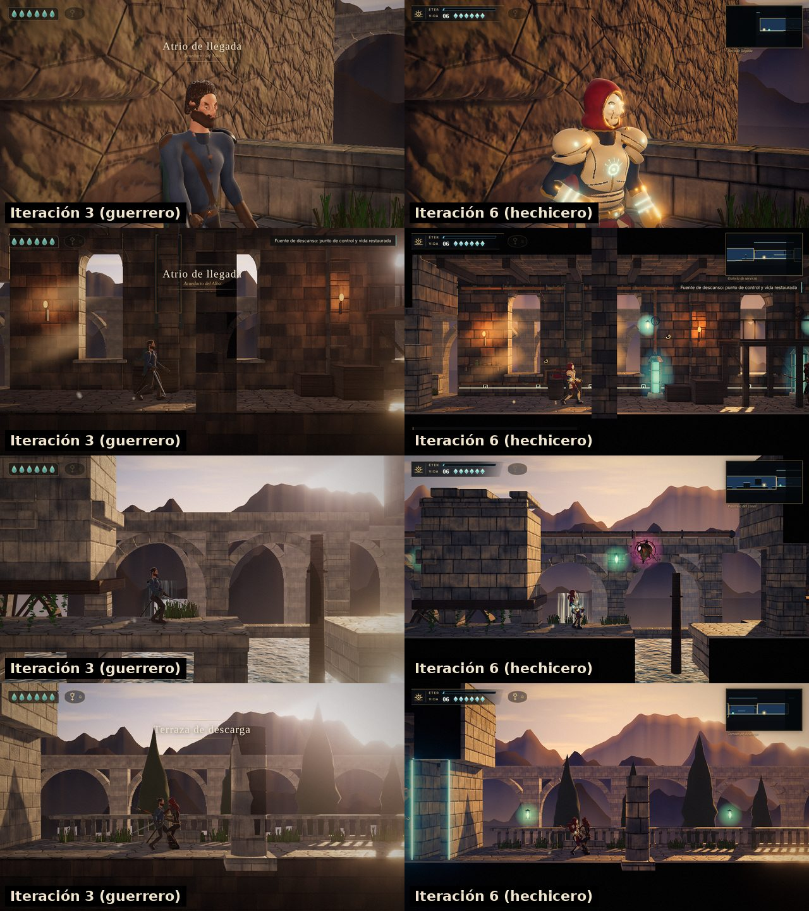

# Iteración 6 — hierba, cordilleras a contraluz y nivel troceado por salas

Cambios aplicados (ver `docs/juez/iteracion-5.md`, «Decisión para la iteración 6»):

- **Recuadros claros detrás de la hierba.** Se aisló con tres capturas de la misma escena (normal,
  sin oclusión ambiental, sin hierba): el pase de normales del AO no respeta el recorte alfa, así
  que cada mata de hierba tapaba el AO de lo que tenía detrás. Las tarjetas con recorte alfa quedan
  fuera del AO.
- **El AO oscurecía las cordilleras**, y solo en calidad alta: en calidad media (sin AO) el fondo se
  veía rosa pálido entre los arcos. El cielo y las cordilleras salen del AO y las cordilleras pasan
  a ser **siluetas oscuras a contraluz con perspectiva aérea** (cada capa más cercana, más oscura y
  con menos neblina). La pendiente que ilumina las laderas se mide en una ventana ancha: antes el
  ruido fino dibujaba franjas verticales, como una cortina.
- **Nivel troceado en tramos de 32 m**: el recorte por frustum descarta las salas que no se ven, en
  el pase principal y en el de sombras.
- **Menos llamadas de dibujo**: cadena del taller (41 eslabones → 1 malla), reja de la compuerta
  (14 → 3), jaula de los faroles de éter (6 → 1 por farol) y piezas de detalle de Aren fusionadas
  por hueso.
- Juntas de sillería más anchas y oscuras (se aplicaron después de la captura del juez; solo
  constan en las métricas por sala).

Pruebas funcionales: 29/29. Errores de consola: 0.

## Métricas de estilo

| Métrica | It. 3 | It. 5 (salas) | It. 6 (salas) | It. 6 (19 capturas del juez) | Mediana de las referencias | Objetivo |
|---|---|---|---|---|---|---|
| Negro % | 9,3 | 30,9 | 29,4 | 22,7 | 23,8 | 15–35 |
| L\* mediana | 23,9 | 13,7 | 16,4 | 19,8 | 17,9 | 12–24 |
| L\* p95 | 57,9 | 77,9 | 77,9 | 68,3 | 68,1 | 55–80 |
| Contraste | 15,2 | 23,8 | 23,4 | 19,7 | 19,7 | 15–25 |
| Acentos % | 0,07 | 0,36 | 0,37 | 0,91 | 0,15 | 0,1–2 |
| Unidad de tono | 0,98 | 0,78 | 0,58 | 0,72 | 0,64 | 0,5–0,85 |
| Detalle % | 2,8 | 4,3 | 4,1 | 4,4 | 6,3 | ≥ 5 |

En las capturas del juez, negro, luminosidad, altas luces y contraste quedan a menos de 2 puntos
de la mediana de las referencias. Seis de siete métricas en objetivo; el **detalle** sigue fuera.
Las juntas más anchas lo subieron solo de 4,0 a 4,1: la métrica se calcula a 640 px y las juntas
desaparecen a esa escala. Cerrar esa distancia exige producción de arte (más piezas modeladas por
sala, paneles y relieves), no un ajuste; esta línea se detiene aquí y queda como trabajo pendiente.

## Puntuación

| Criterio | Peso | It. 3 | It. 4 | It. 5 | It. 6 | Motivo de la última nota |
|---|---|---|---|---|---|---|
| Gráficos e iluminación | 25 % | 6,2 | 6,4 | 6,6 | **6,9** | Sin recuadros en la hierba; fondo a contraluz igual en todas las calidades; luz de las capturas casi en la mediana de las referencias. Resta el detalle bajo |
| Animación | 20 % | 6,2 | 6,3 | 6,3 | **6,3** | Sin cambios: animación procedural, sin captura de movimiento |
| Control y sensación | 20 % | 7,0 | 7,3 | 7,3 | **7,3** | Sin cambios de mecánica; 29/29 |
| Diseño de nivel | 15 % | 6,8 | 7,0 | 7,0 | **7,0** | Sin cambios |
| Estética y legibilidad | 10 % | 6,0 | 6,5 | 6,8 | **6,9** | Las siluetas del fondo separan los planos; Δ ≥ 12 en 17/19 (09_desliz 11,8; 07 es el destello del desvío) |
| Rendimiento y estabilidad | 10 % | 7,0 | 6,0 | 6,3 | **7,0** | En juego: 92–166 llamadas y 252k–410k triángulos (antes 97–180 y 320k–483k); solo los tres planos de combate de la galería rozan el presupuesto |
| **Global** | | **6,5** | **6,6** | **6,7** | **6,9 / 10** | |

## Balance del ciclo v2 (iteraciones 4–6)

La nota pasa de 6,5 a 6,9. Lo que más cambió frente a la iteración 3:

- **Aren** es un hechicero acorazado con silueta propia (capucha carmesí, hombreras de marfil,
  focos cian) y se separa del fondo en 17 de 19 capturas (antes 5 de 14).
- **La imagen** pasó de un gris monocromo (unidad de tono 0,98, 9 % de negro) a masas negras,
  acentos fríos y altas luces cálidas con cifras cercanas a las referencias.
- **Jugabilidad**: saeta con carga, apuntado en 8 direcciones, paso etéreo, desvío con
  contraconjuro, sello que solo cede a las saetas, un enemigo a distancia y minimapa.

Lo que sigue separando el nivel del 10 (el acabado de las referencias):

1. **Detalle por sala** (4,1–4,4 frente a 6,3): faltan piezas modeladas a mano y relieves.
2. **Animación procedural**: correcta pero sin el peso de una animación capturada o hecha a mano.
3. **Rostro y manos** de los personajes: superficies SDF sin escultura ni texturas de alta
   resolución; el rostro de Aren funciona como máscara estilizada.
4. **Medición**: SwiftShader en CPU; el tiempo de simulación oscila entre 0,8 y 1,7 ms según la
   carga de la máquina y no hay FPS reales. Hay que comprobarlo en un equipo con GPU (`F3`).

## Métricas del motor

| Captura | L* medio | L* p5–p95 | Recorte % | Negro % | Héroe Δ borde | Enemigos Δ borde | Llamadas (principal / con sombras) | Triángulos (principal / con sombras) |
|---|---|---|---|---|---|---|---|---|
| 01_retrato | 25.7 | 6.4–64.4 | 0.22 | 0.54 | 17.6 | — | 63 / 123 | 464k / 911k |
| 02_carrera | 26.5 | 0.5–78 | 0 | 21.57 | 15.7 | — | 92 / 152 | 252k / 431k |
| 03_salto | 25.8 | 0.5–77.5 | 0 | 25.58 | 19.7 | — | 100 / 164 | 252k / 456k |
| 04_galeria | 16 | 0.4–50.5 | 0.17 | 29.2 | 16.8 | 32.3 | 141 / 232 | 321k / 639k |
| 05_telegrafia | 14.5 | 0.4–47.7 | 0.21 | 28.54 | 19.6 | 45.9 | 161 / 251 | 410k / 729k |
| 06_parada | 30.5 | 17.4–57.8 | 0.26 | 0 | 13.4 | 15.7 | 165 / 255 | 410k / 729k |
| 07_contraataque | 28.7 | 10–67.4 | 1.31 | 0 | 8.2 | 6.3 | 166 / 256 | 410k / 729k |
| 08_borde | 30.8 | 3.5–79.7 | 0 | 1.74 | 12.3 | — | 93 / 201 | 336k / 635k |
| 09_desliz | 31.6 | 0.6–77.2 | 0.01 | 11.89 | 11.8 | — | 111 / 220 | 327k / 616k |
| 10_canal | 28.9 | 0.5–82.3 | 0.04 | 19.53 | 22.9 | — | 119 / 227 | 289k / 564k |
| 11_taller | 16.7 | 0.4–50.2 | 0.1 | 26.91 | 20.5 | — | 138 / 254 | 318k / 609k |
| 12_clavija | 21.9 | 3.7–59.1 | 1.27 | 3.2 | 16.5 | — | 109 / 225 | 571k / 1129k |
| 13_compuerta | 35.6 | 3.7–77.9 | 0.75 | 4.14 | 18.7 | — | 129 / 252 | 528k / 1046k |
| 14_terraza | 31.9 | 0.6–81.6 | 0.29 | 22.99 | 13.2 | 15.2 | 140 / 261 | 278k / 529k |
| 15_sello | 31.3 | 0.6–81.5 | 0.04 | 13.74 | 19.9 | — | 117 / 214 | 264k / 496k |
| 16_vigia | 30.9 | 0.6–81.3 | 0.01 | 14.92 | 22.4 | — | 124 / 246 | 323k / 614k |
| 17_carga | 20.1 | 0.6–61.1 | 0.07 | 28.78 | 18.5 | — | 127 / 254 | 293k / 613k |
| 18_cargada | 22.2 | 0.6–63.8 | 0.3 | 26.17 | 14.3 | — | 131 / 258 | 293k / 614k |
| 19_apuntado | 19.5 | 0.4–59.6 | 0.25 | 28.58 | 19.9 | — | 132 / 259 | 293k / 614k |

- Mediana de separación del héroe: **17.6**; capturas con Δ ≥ 12: **17/19**.
- Altura de Aren en pantalla (mediana): **18.9 %** del alto del cuadro (objetivo v2: 14–20 %).
- Mediana de separación de enemigos: **15.7** (5 mediciones).
- Simulación y animación en CPU: 1.70 ms por paso de 1/60 s en esta captura (0.79 ms en la
  iteración 5 con la misma simulación: la cifra depende de la carga de la máquina).
  Carga en el navegador sin cabeza: 21.1 s (construcción del mundo 12.0 s). Errores: 0.
- 01, 12 y 13 son planos cortos con el modelo fino de Aren; el presupuesto se aplica a los
  encuadres de juego.

