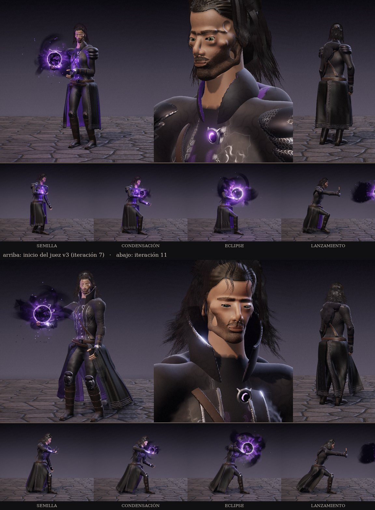

# Iteraciones 7–11 — juez estricto del mago de sombras (v3)

Referencia: la lámina «UMBRAL · Mago de Sombras» que entregó la usuaria (no se versiona; sus cifras
están en `tests/judge/referencia_mago.json`). Rúbrica y topes en [`../CALIDAD.md`](../CALIDAD.md),
sección v3. Cada ronda captura la lámina del motor en el estudio del personaje, la compara lado a
lado con la referencia y comprueba en el juego la secuencia de carga.

## Rondas

**7 · Rostro, cabello y poder en el juego.** Ojos con iris de fibras y córnea húmeda, orejas con
hélice y lóbulo, relieve anatómico como desplazamiento de milímetros, barba corta con vello dibujado
por el sombreador, cabello por hebras en los planos cortos (tarjetas en el juego). El eclipse entra
en el juego con sus cuatro fases (0,3 / 1,5 / 3 s) y un sonido de carga nuevo.

**8 · Vestuario.** El abrigo pasa de falda corta cerrada a faldones hasta media caña abiertos en V
invertida (el canto delantero se aparta conforme baja y deja ver las piernas y el forro violeta).
Solapas con grosor propio y ribete de plata, hombros menos abultados (hombrera de tres láminas,
brazo menos voluminoso), rodilleras articuladas con lamas, correas con hebilla que siguen la caña
de la bota y arrugas de cuero en el tobillo. En el plano de 3/4 la esfera se **ofrece** al costado a
la altura del hombro, como en la lámina, con contrapposto y la otra mano relajada.

**9 · Rostro y cuello.** El retrato se encuadra como el recuadro de la lámina (cabeza girada hacia
la derecha de la imagen, ojos a algo más de un cuarto de la altura). Tono de piel calibrado con
muestras de la referencia (luz 173/128/108, sombra 91/65/56): antes salía anaranjado y saturado.
Párpados menos hinchados, ojos 1,5 mm más hundidos bajo un arco superciliar más marcado, pómulo y
mejilla hundida más claros, surco nasogeniano. Cuello alto del abrigo que se abre en embudo detrás
de la nuca y camisa de cuello alto: el cuello desnudo ya no domina el retrato.

**10 · Cabello y fases del poder.** Melena castaña oscura (antes casi negra) con ondas más amplias,
volumen y puntas que se abren; brillo especular contenido. Fases con zancada de casi un metro (el
pie de delante bajo la esfera, el de atrás estirado), pelvis baja, torso inclinado y la mano más
adelantada; el lanzamiento conserva la base de la fase y el peso va adelante. El poder levanta un
**viento** que echa atrás los faldones, más fuerte con cada fase y con un golpe al soltar (también en
el juego). Corona del orbe menos violeta: la esfera se lee negra, como en la lámina.

**11 · Capucha.** La capucha caída pasa de una cadena de bolas a un rollo continuo de tela que se
afina y baja hacia las clavículas.

Pruebas funcionales: 30/30. Errores de consola: 0.

## Métricas por recuadro (motor / referencia)

| Recuadro | detail it. 7 | detail it. 11 | ref. | fine it. 7 | fine it. 11 | ref. | violeta % it. 7 | it. 11 | ref. |
|---|---|---|---|---|---|---|---|---|---|
| Cuerpo 3/4 | 1,88 | 2,88 | 6,97 | 6,70 | 7,44 | 7,00 | 6,47 | 7,01 | 0,63 |
| Rostro | 2,84 | 3,08 | 6,36 | 6,74 | 7,79 | 8,37 | 3,50 | 0,21 | 0,41 |
| Espalda | 2,44 | 2,82 | 6,63 | 7,63 | 7,96 | 7,18 | 0,11 | 0,10 | 0,39 |
| Semilla | 1,39 | 1,29 | 6,01 | 4,35 | 4,38 | 6,28 | 4,38 | 1,59 | 0,13 |
| Condensación | 1,54 | 1,81 | 7,23 | 4,42 | 4,67 | 7,30 | 6,46 | 2,98 | 0,73 |
| Eclipse | 1,15 | 1,82 | 8,16 | 4,15 | 4,67 | 8,01 | 13,00 | 7,73 | 1,99 |
| Lanzamiento | 1,32 | 1,23 | 7,62 | 4,28 | 4,37 | 7,55 | 2,77 | 0,11 | 1,32 |

La textura fina ya iguala a la lámina en los planos grandes; el **detalle** (bordes legibles) sigue
en un 30–45 % del de la referencia. Una parte es el fondo pintado de ruinas, que el plató neutro no
tiene; la otra es real: la lámina tiene bordados, repujados y costuras en casi cada superficie. El
violeta del eclipse bajó a menos de 4 veces el de la lámina (tope del poder superado). En el cuerpo
de 3/4 el violeta sigue alto por el forro del abrigo y el brillo de la esfera junto a la mano.

## Nota del juez (10 = la lámina)

| Criterio | Peso | It. 7 | It. 11 | Qué falta |
|---|---|---|---|---|
| Rostro y cabello | 25 % | 2,5 | 3,5 | El rostro sigue leyéndose como un maniquí: planos demasiado lisos, transición dura entre luz y sombra, sin la asimetría ni la piel de la pintura. El cabello ya tiene volumen y ondas, pero sin mechones sueltos finos ni el moño visible de la espalda |
| Vestuario | 25 % | 3,5 | 5,0 | Repujado y filigrana en todo el abrigo (la lámina tiene volutas en cada faldón), capucha con pliegues profundos, hombreras más angulosas |
| Manos y gestos | 15 % | 4,5 | 5,0 | Gestos correctos (ofrecer, cuenco, garra, contener, lanzar); faltan tendones, nudillos y la tensión de la mano abierta |
| Poder | 15 % | 5,0 | 5,5 | Humo negro más denso y ramificado y rayos finos alrededor del núcleo |
| Poses y naturalidad | 20 % | 3,0 | 5,0 | El abrigo aún tapa las piernas de perfil; la zancada de la lámina es más baja y el giro de hombros al lanzar, mayor |
| **Ponderada** | | **3,5** | **4,7** | |

## Distancia honesta

La lámina es una ilustración pintada a mano. El juego genera el personaje entero con código
(superficies implícitas, pintura por vértice, sin escaneos ni texturas pintadas) y lo dibuja en
tiempo real en el navegador. Con esa ruta el vestuario, las poses y el poder pueden seguir subiendo
hacia 6–7; el **rostro** es el techo: llegar al realismo de la pintura exigiría una malla esculpida o
escaneada con texturas de piel, que hoy no forman parte del proyecto (todo el contenido es propio y
generado). El siguiente paso con más rendimiento es el repujado y la filigrana del abrigo y una
pasada de forma del rostro (planos de la cara más estrechos, transición de piel más suave).
